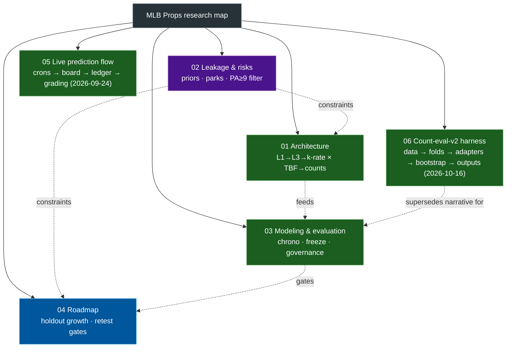

# Index — MLB Props research map

Five phase diagrams (01-05), the three coordinated views below, and the
count-eval-v2 harness diagram (06). Open each file for detail; this index only shows how they
relate.

> **Current research state (2026-10-16):** [`../reference/current_state_2026-10-16.md`](../reference/current_state_2026-10-16.md) — PA population, harness mechanics, closed model-family question, test sequence. The dated snapshots below are lineage records; when they disagree with the current-state page, the current-state page describes now.

> Live ops / approvals / deferred work: [`docs/EXECUTION_BACKLOG.md`](../EXECUTION_BACKLOG.md).
> This index is a research-status map, not the work queue.

**Status snapshot (2026-09-11, replay era):**

- **Frozen stack:** k-rate ensemble (train 2023–24) × TBF ridge → **Poisson** count layer → **WS1c per-line Platt** (live 2026-09-10) → policy filter → 1/16-Kelly → SharpAPI board.
- **Live policy (champion, promoted 2026-09-11):** line floors + 4.5-over veto + 2.5/3.5 probation + edge cap 0.24 + under-lean +0.04 + DK+FD-only + offset clip ±0.02 (`kpi_policy.json`; pin green).
- **Replay era (supersedes the 08-21 snapshot below):** vendor envelopes recovered (9,189 files); juiced 1u ledger (full-season resim +5.3% / +8.7% DK+FD, rejects kept); 2025-lock selection rebuilt-panel truth (champion 2025 n=505 +11.0% LCB +3.0% White p=0.0075, 2026 judge n=460 +8.8% LCB +0.2% disclosed peek; 9/11 pre-WS1c +15.5%→+15.6% superseded); slate totals joined (1,633 correlated pairs). Details: `docs/reference/oddsapi_replay_architecture.md`, `freeze_playbook_2026-09-11.md`.
- **Retrain closed** (walk-forward dead, #66). Reopen only on new data or offseason review.
- Prior 2026-08-21 snapshot retained below for lineage (isotonic pointer, 1/16-Kelly now — the "⅛ Kelly" line below is stale).

- **Feature spine locked:** LightGBM `production` **184** (Step 11 discipline
  lift on Step 10 P1) ×
  Ridge thin-bullpen TBF × count layer v1 (`p_over` lines **2.5…9.5**).
- **Phase 11.A–C done** (verification: HPO flat, WF expected_K ≈ 1.78, ECE ≈
  0.024) — `docs/research/phase11_model_quality_gates.md`.
- **Post-hoc isotonic `p_over_*` calibration** promoted in production pointer
  (`docs/research/prob_calibration_findings.md`); raw probabilities retained.
- **Phase D interim policy frozen** (~3.5% excluded by `PA≥9`) —
  `docs/research/phase_d_population_findings.md`. Pregame role labels still open for
  pristine v1.
- **Live + paper trading shipped:** morning log/grade → SharpAPI `odds_board` →
  `poll_odds open` (board-derived with `--from-recommendations`) → tip-window
  `close_watcher` → settle/CLV skill tracker — `production/README.md`,
  `docs/reference/market_clv_gates.md`.
- **CLV skill suite shipped (2026-08-06):** `production/notebooks/results_dashboard.ipynb`
  §11-20: reliability+z-test / residual decomposition / chrono recalibration /
  model health scorecard / BCa-CLV checkpoint framework — see
  `docs/research/notebook_change_log.md`. Floor + Kelly: edge floor with
  1/16-Kelly sizing realized as flat $50u (Kelly fractions anchor to 1u at
  this bankroll; flat wins paper ROI per 04-roadmap line 72 — the "⅛ Kelly"
  wording below is stale).
- **Execution vs research gate split wired:** execution lane tracks freshness,
  quote coverage, and board↔ledger parity; research lane tracks counterfactual
  confidence and long-horizon skill.
- **Focused monitoring split shipped:** KPI monitor / calibration lab / gate
  policy simulator view / PnL+CLV monitor now complement the deep-dive dashboard
  (`production/notebooks/results_*.ipynb`, `production/ops/policy_simulator.py`).
- **Exit-anomaly governance shipped:** source-tagged override table, training
  mask, confidence-aware rolling contamination policy, and WF A/B+sensitivity
  runners. Current 2023-2024 historical tag density is low, so aggregate WF
  deltas are neutral so far.
- **Next:** grow post-freeze holdout and monitor CI tightening; rerun
  challenger/promotion cycles only after explicit re-test criteria are met.
- **Deferred (not critical path):** Marcel age curve, Steamer/ZiPS/PECOTA floors,
  NB/mixture count challengers — see `docs/diagrams/04-roadmap.md` § Later.
- **Lineup:** training uses first-9-by-PA proxy; live uses announced RG order;
  ID resolve `active → 40Man → fullSeason` — `docs/reference/lineup_train_serve.md`.
- Do not reuse scored 2025 for selection or “final” metrics.

> Verified 2026-09-30: snapshot above retained as the 2026-09-11 replay-era record; current live claims defer to the backlog Session Snapshot + `docs/reference/golden_metrics.md`.

## Three coordinated views (added 2026-10-09, docs-only)

> Verified base: committed `31e9891`. Later bridge/WF work is not included
> unless separately identified below as reported (not inspected here).

This section does not replace the phase diagrams above. It maps them to the
bounded documentation task: separate what is operational, what is built
research, and what is proposed. Statuses use solid edges for verified
implemented paths and dashed edges for proposals. Research never feeds
production automatically.

| View | Files | Question answered |
|---|---|---|
| A. Current operational implementation | `01-architecture.md` + `05-live-prediction-flow.md` | How the frozen ensemble, point workload, count model, calibration, and market handling connect today (code exists; scheduler paused for postseason HOLD) |
| B. Built research and evaluation chain | `03-modeling-and-evaluation.md` (+ `02-leakage-and-risks.md` constraints) | How log5, BF PMF, K combiner, and the evaluation package work; which challengers were rejected |
| C. Proposed offseason architecture | `04-roadmap.md` View C section | How PA-level ML, historical features, workload uncertainty, and aggregation could replace individual components |

### Status legend (applies to all three views)

- `EXISTING` — implemented on the production path (solid edge).
- `RESEARCH-BUILT` — built and evaluated in `research/offseason_2026/`, never promoted (solid edge inside research only).
- `PENDING-INTEGRATION` — built but awaiting a gated promotion decision (dashed edge to production).
- `PROPOSED` — design/spec only, no implementation (dashed edge).
- `REJECTED` — evaluated and closed by a frozen gate (listed, never drawn as live).
- `UNRESOLVED` — known discrepancy or missing validation; do not cite as fact.

Training and pregame inference are separate lanes. Forecast cutoff: no feature
may use information at or after first pitch. Code existence is not deployment:
a production code path can exist while its scheduler is paused.

### Walkthrough (30 seconds per view)

- View A: `statcast.py` -> `pipeline/games.py` (L1) -> `pipeline/rolling.py`
  (L2) -> `pipeline/training.py` (L3) -> `features.py` gate -> frozen k-rate
  scorer (`live_assembly.py` + `live_krate_ensemble.json`) and frozen TBF Ridge
  (`models/TBF-Model/`) -> `count_layer.py` Poisson `P(K >= line)` ->
  WS1c per-line Platt (`prob_calibration_production.json`) -> `kpi_policy.json`
  filter -> flat $50u sizing (`market.py`) -> `odds_board.py` ->
  `poll_odds.py --from-recommendations` -> `odds_ledger.py` -> `grade_odds_ledger.py`
  (settle + CLV). Live crons (`modal_app.py`, 5x `modal.Cron`, NY-local) drive
  the daily side branch; training never reads the live branch.
- View B: PA dataset (`pa_dataset_contract.md` + manifest) -> PA-1A batter
  tendency -> P3-log5 pitcher prior (promoted reference) -> L3 ridge logistic
  (`logistic_pa/`, DEVELOPMENT baseline, reproducible to 2.2e-16) -> tree
  challenger (`tree_pa/`, TIE, blend rejected, lane CLOSED) -> workload spine
  (`workload_spine.py`) + BF distribution (`bf_distribution.py`) + log5/K
  combiner (`kcount_combiner.py`) + evaluation package (`eval_package.py`) ->
  dated run dirs with card/metrics/manifest. Rejected challengers stay listed
  in View B; they do not appear in View A.
- View C: PA classifier (PROPOSED LightGBM binary, after L3) with historical
  features -> per-PA K probabilities -> Poisson-binomial aggregation over a BF
  PMF (PROPOSED, replaces point-xTBF Poisson) -> recalibration candidate
  (separately fitted/evaluated, not automatic) -> policy reuse candidate
  (proposal, not decided). Independence and workload-dependence limits apply.
  The authorized chronological WF comparison lives in the research window;
  this docs window launches no experiment.

### Newer work outside the verified base (reported, not inspected here)

- The LightGBM bridge is reportedly implemented and diagnostic-scored in the
  other window (uncommitted): selection-aware, matched-population-limited, no
  promotion. Its code was not inspected from this worktree.
- A bounded chronological WF comparison is authorized in the research window.
  Execution/completion status must be confirmed by that owner; this docs task
  describes that status and queues nothing.
- PA-level LightGBM and Poisson-binomial integration remain PROPOSED unless
  verified implementation evidence exists. Calibration and policy reuse are
  candidates, not requirements. Existing PA prototypes (PA-1A, P3-log5, L3,
  tree) stay distinct from any proposed new experiment.

### Plain-language math (one place; diagrams point here)

- Rate estimate vs strikeout probability: k-rate is expected K per PA over
  many PAs; a PA K probability is one coin flip for one PA.
- Point BF estimate vs BF PMF: point BF is one number (e.g. 23.4); a BF PMF is
  a full distribution over possible BF values (20, 21, 22, ...).
- Conditional K distribution vs marginal K PMF: conditional means "if BF were
  exactly N"; marginal mixes those over the whole BF PMF.
- Binomial mixture (retained reference): pick BF from the PMF, then flip N
  biased coins. Simple and honest about workload risk.
- PA classifier + Poisson-binomial (PROPOSED): learn each PA's own flip bias
  from matchup features, then add up different-biased flips. Stronger if
  matchup signal is real; assumes flips are independent given features, which
  breaks if pitcher fatigue or game state couples PAs.
- Expected K vs median vs interval vs milestone probability: mean, middle,
  range covering most outcomes, and `P(K >= line)` for one betting line.
- Probability calibration vs ability-estimation uncertainty: calibration fixes
  "probabilities say 30% but it happens 25%"; ability uncertainty is "we are
  unsure how good the pitcher is." Fix one does not fix the other.
- Market disagreement vs expected profit: disagreeing with the market is not
  profit until price, stake, and fills are accounted for.

### Evidence and lessons (adjacent table; numbers live here, not in boxes)

Sources are canonical manifests/cards/reports. Populations and recipes differ
across rows; never substitute one row for another. Bias sign: prediction minus
observed (positive = overprediction) unless noted. CIs are game-date-clustered
bootstrap percentile-95 unless noted.

| Finding | Population / n | Recipe | Metric + interval | Caveat |
|---|---|---|---|---|
| Workload uncertainty helped the initial count comparison | Reported 4,446 paired cases (external packet; NOT independently verified in this worktree) | BF PMF vs rounded point exposure | Count-distribution score, challenger better | No manifest inspected here; cite only as reported |
| PA-1A batter signal survives both blocks | 2024 E1 55,815 / E2 50,252 primary PA rows, identical across arms | Shrunk batter tendency vs pitcher-only M1 | PA logloss/Brier, date-clustered CIs exclude zero | M1 weaker than league constant in E1 (cold start); source `pa1a_raw_pa/card.json` + phase4/5 record |
| Starter attribution reconciles | 4,711 official-starter starts, exact BF reconcile | K to completing pitcher; split-PA flagged | 100% starters reconcile | Oracle lane only; no production/market claim |
| P3 pitcher prior promoted | Same E1/E2; m=100 selected on 2023 folds only | Prior+current shrinkage, log5 with PA-1A batter | Beats M2 logloss both blocks | Relief-only priors inseparable; source `pitcher_prior/card.json` |
| L3 = development PA baseline | Fit 2023 (105,225 rows); eval E1/E2 | Ridge logistic + trip dummies + starter_pa_index/9 | Beats P3-log5 both blocks, 100% Fav; reproducible to 2.2e-16 | DEVELOPMENT only; F6 rest excluded; source `logistic_pa/card.json` |
| Tree challenger TIE / CLOSED | Same E1/E2 | Constrained tree + blend gate (corr 0.9965 fail) | No separation under oracle aggregation | Blend rejected; L3 retained; source `tree_pa/card.json` |
| September workload correction REJECTED | DEV 2023 n=4,446 (sept 814); CONFIRM 2024 n=4,386 (sept 770) | Hazard challenger, frozen contract, fixed-p* | 2024 primary 2/5, safety 5/6; Sept BF bias 0.595->0.081 but K +0.010->-0.105 | BF repair real both seasons; K had no defect to fix in Sept 2024; lane CLOSED; source backlog PRESENT 2026-10-09 + `sep-challenger-contract.md` |
| Tail redistribution degraded upper-K reliability | Reported in external packet; manifest not inspected here | Tail re-allocation over BF PMF | Upper-K reliability worse | Better workload bias does not imply better K probs; mark reported |
| Historical outcomes informed ensemble selection | 2025-select / 2026-judge design | Outside-training is not independent validation | Champion 2025 n=505 +11.0% LCB +3.0%, White p=0.0075; 2026 n=460 +8.8% | Validation claim limited; source `golden_metrics.md` |
| Workload diagnostics (developmental, non-comparable) | 2023 first-pitcher BF>=1 n=2,400; Apr n=452; 2024 n=2,333 | Corrected-history / April-extension / 2024-transfer | Paired MAE diffs -0.327 [-0.416,-0.240], -0.226, -0.223 | Retrospective identity; no transfer; never substitute for frozen rows; source `golden_metrics.md` G |
| September bias discrepancy UNRESOLVED | Sept 2024 BF bias reported +0.767 (transfer run) vs +0.595 (challenger reference) | Different populations / reconstruction paths | Both can be correct for their recipe | Do not silently choose one; reconciliation pending; needs explicit manifest + population + sign convention |

### Verified vs unresolved (2026-10-09; base `31e9891`)

Verified in this worktree from committed code/cards at `31e9891`: pipeline
L1-L3 files exist; `count_layer.py`, `market.py`, `live_assembly.py` exist; PA
prototypes `pa1a_raw_pa/`, `pitcher_prior/`, `logistic_pa/` (bundle+sidecar),
`pa1b_oracle_xk/`, `tree_pa/` exist with cards; research `eval_package.py`,
`kcount_combiner.py`, `bf_distribution.py`, `workload_spine.py` exist; frozen
stack definition and policy files match `CONTEXT.md`; postseason HOLD state
matches the backlog snapshot at this base.

Unresolved: artifact hashes establish current reference only (no older trusted
hash agreement); training-frame vs sidecar hash difference; PA denominator
mismatch across implementations; September +0.767 vs +0.595 reconciliation;
4,446-case count-integration packet not independently inspected; tail-redist
manifest not inspected; proposed PA-LightGBM vs existing logistic lineage
needs explicit training contract before any comparison. Newer bridge/WF work
is reported-only (see section above) and was not inspected here.

### Ranked implementation gaps (docs view; execution needs owner order)

1. September bias reconciliation note (manifest + population + sign) — small,
   unblocks evidence table currency.
2. Count-distribution spec (Poisson vs Poisson-binomial) with frozen eval
   package — scoped after the authorized WF comparison reports.
3. 2025 validation lanes A-D spec — after (2).
4. Repo cleanup pass (read-only inventory first; GC skill + keep/hold/delete)
   — separate task after active branches land.

No experiment is queued by this docs window. The bounded chronological WF
comparison is authorized in the research window; its execution/completion
status belongs to that owner. This window stops after the docs commit.

### Proposed architecture set (2026-10-21; PROPOSED status, owner approval pending)

- [07 - Lanes and responsibilities](07-lanes-and-roles.md) - who builds, reviews, authorizes execution, approves promotion.
- [08 - Research decision flow](08-research-decision-flow.md) - frozen baseline, rejected batter-history recipe, Question A/B lanes, promotion gates.
- [09 - Evidence gate](09-evidence-gate.md)
- [10 - System paths](10-system-paths.md) - production vs research boundary: inputs, components, outputs, promotion gate (reuses 01/05/08 for depth).
- [11 - Experiment flow](11-experiment-flow.md) - frozen inputs -> paired arms -> scoring -> uncertainty -> decision. - pre-registration -> single run -> receipt -> reviewer verification -> closeout (ADR-0001).
- ADR-0001 (evidence gates), ADR-0002 (exact aggregation first), the cycle PRD, and ROLES live in \docs/architecture/\.
