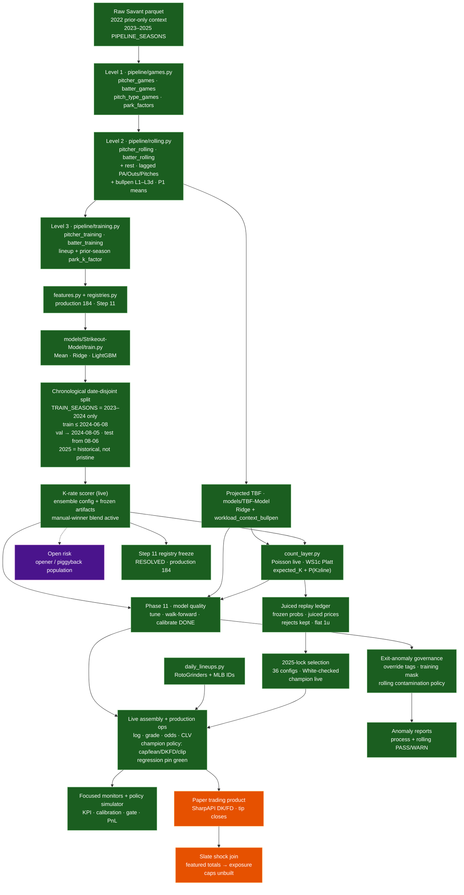

# 01 — Architecture (View A: current operational implementation)

> Verified base: committed `31e9891`. Later bridge/WF work is reported-only
> (see `00-index.md`) and is not drawn here.

Production research path for pregame pitcher `k_rate = K / PA`, plus the frozen
TBF → count-layer spine. Live scoring + paper trading are a **side branch** and
do **not** feed Level 3 historical training.

> View A status: all green nodes below are EXISTING. Amber is PARTIAL
> (shipped but sample/ops still building). Purple is RISK (open method issue).
> Solid edges are verified implemented paths. Training (top-down) and pregame
> inference (side branch) are separate lanes. Forecast cutoff: no feature may
> use information at or after first pitch. Code existence is not deployment:
> the live path exists while its scheduler is paused for postseason HOLD
> (season ended 2026-09-27; app STOPPED per backlog snapshot).

## Notes

- View A component contract (input -> output; unit; cutoff). Numbers live in
  `00-index.md` evidence table, not in boxes.
  - RAW Savant parquet -> L1 `pipeline/games.py` (pitch units -> pitcher-game /
    batter-game rows; cutoff: prior games only).
  - L1 -> L2 `pipeline/rolling.py` (game rows -> rolling features + rest +
    bullpen; cutoff: prior-game only, season resets yearly).
  - L2 -> L3 `pipeline/training.py` (rolling -> training rows; historical
    lineup proxy `is_initial_lineup`, never live lineups).
  - L3 -> `features.py` gate (training rows -> 184-col production frame;
    rejects unexpected numerics; Step 11 freeze).
  - Frame -> `models/Strikeout-Model/train.py` (frame -> k-rate scorer;
    TRAIN 2023-24 only; 2025 historical-not-pristine).
  - L2 -> `models/TBF-Model/` Ridge (rolling -> projected TBF point estimate;
    same-game TBF never a feature).
  - k-rate x TBF -> `src/Python/count_layer.py` Poisson (rate x workload ->
    `P(K >= line)` 2.5-9.5; retained reference is binomial mixture over BF).
  - Counts -> WS1c per-line Platt (`prob_calibration_production.json`, live
    2026-09-10; isotonic retired) -> `kpi_policy.json` filter (prob ->
    BET/HOLD; floor 0.12, veto over@4.5, probation, cap 0.24, DK/FD).
  - Policy -> `market.py` sizing (1/16-Kelly anchor, realized flat $50u) ->
    `odds_board.py` -> `poll_odds.py --from-recommendations` (board-parity
    locked) -> `odds_ledger.py` (slate/ticket grain, one slip per signal) ->
    `grade_odds_ledger.py` (settle + CLV; void PPD-24h).
  - Lineups: training proxy vs live `daily_lineups.py` (announced RG order;
    inference-only).
- Historical opposing lineup uses `is_initial_lineup` (first nine distinct
  batters by first PA), not `daily_lineups.py`.
- Level 1 retains workload foundations (`Pitches`, `PA`, `Outs`). Level 2 emits
  lagged `PA_P*` / `Outs_P*` / `Pitches_P*`, rest flags, bullpen lookbacks, and
  mean windows including **P1** for physics stems used in Step 10.
- Workload / rest / bullpen columns are **experimental** for the k-rate gate;
  frozen LightGBM production does not consume them (they feed TBF).
- Companion feature set `step7_185` retains the pre-P1 freeze for bake-offs.
- Phase 11 gates: `docs/research/phase11_model_quality_gates.md` (done).
- Live ops: `production/README.md`; market protocol: `docs/reference/market_clv_gates.md`.
- Active live k-rate blend config: `production/ops/live_krate_ensemble.json`.
- Focused monitoring loop: `production/notebooks/results_kpi_monitor.ipynb`,
  `results_calibration_lab.ipynb`, `results_gate_policy.ipynb`,
  `results_pnl_clv.ipynb`, and `production/ops/policy_simulator.py`.
- Exit-anomaly layer is postgame governance only (no pregame leakage): source tags,
  training mask, rolling-policy weighting, and walk-forward A/B harness.
- `PROJECTION_SEASON = 2026` exists in config for forward park/projection work.
