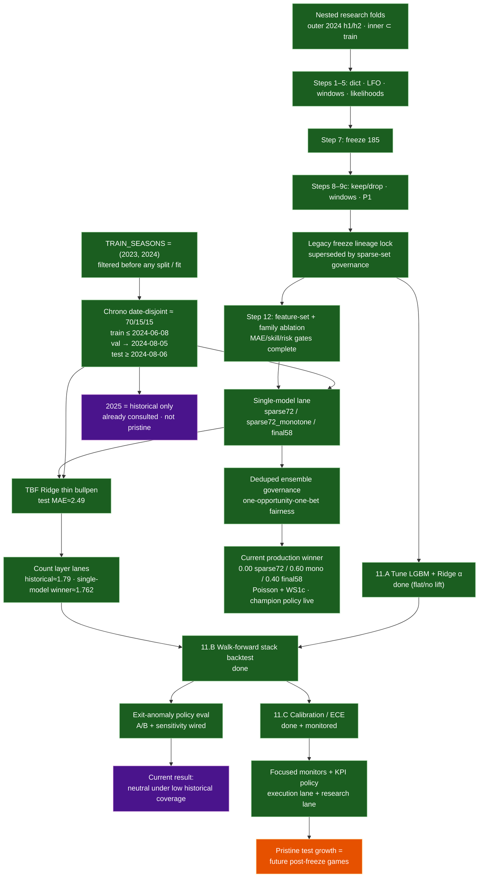

# 03 — Modeling and evaluation (View B: built research and evaluation chain)

> Verified base: committed `31e9891`. Later bridge/WF work is reported-only
> (see `00-index.md`) and is not drawn here.

Chronological evaluation of the strikeout-rate model, frozen feature gates,
and the shipped model-quality + calibration governance loop.

> View B status: green below is EXISTING (frozen production lineage) or
> RESEARCH-BUILT (built + evaluated in `research/offseason_2026/`, never
> promoted). Dashed edges are proposals. REJECTED challengers are listed,
> never drawn as live. Research never feeds production automatically.

## Notes

- View B research chain (RESEARCH-BUILT unless marked; all docs-only here).
  - PA dataset: `research/offseason_2026/specs/pa_dataset_contract.md` +
    manifest (PA grain, binary K target conditional on PA occurring; input
    pitch rows -> output PA rows with attribution; K to completing pitcher,
    split-PA flagged).
  - PA-1A batter tendency: `experiments/pa1a_raw_pa/run_pa1a.py` (RESEARCH-BUILT;
    shrunk batter rates; survives both 2024 blocks).
  - P3-log5 pitcher prior: `experiments/pitcher_prior/` (RESEARCH-BUILT,
    promoted reference/rollback; m=100 selected on 2023 folds; log5 with PA-1A).
  - L3 ridge logistic: `experiments/logistic_pa/` + `bundle/` manifest +
    sidecar (RESEARCH-BUILT, DEVELOPMENT baseline, NOT production; trip
    dummies + starter_pa_index/9; F6 rest excluded; reproducible to 2.2e-16).
  - Tree challenger: `experiments/tree_pa/run_tree.py` (REJECTED: TIE, blend
    gate failed corr 0.9965, lane CLOSED; L3 retained).
  - Oracle aggregation: `experiments/pa1b_oracle_xk/run_pa1b_o.py`
    (RESEARCH-BUILT diagnostic; oracle lineup lane only).
  - Workload spine: `research/offseason_2026/workload_spine.py`
    (RESEARCH-BUILT point-BF reference).
  - BF PMF: `research/offseason_2026/bf_distribution.py` +
    `run_bf_distribution_2023.py` (RESEARCH-BUILT; point xTBF insufficient).
  - Log5 rate + K combiner: `research/offseason_2026/kcount_combiner.py` +
    `run_kcount_integration_2023.py` (RESEARCH-BUILT; conditional-K to
    marginal-K PMF; binomial mixture retained reference).
  - Evaluation package: `research/offseason_2026/eval_package.py`
    (RESEARCH-BUILT; PA prob, xK, distributions, market-line probs, betting
    slices; date-clustered bootstrap).
  - History/transfer lanes: `run_corrected_history_2023.py`,
    `run_i3_transfer_2024.py`, `run_i3_opportunity_2023.py`,
    `run_i4_card_source_2023.py`, `run_i5_tail_2023.py`,
    `run_sep_challenger.py` + frozen `sep-challenger-contract.md`
    (REJECTED September hazard challenger: BF repair real both seasons, K
    degraded in 2024 confirm; lane CLOSED).
  - Inventory rule: do not assume the proposed PA LightGBM is the first PA
    model. Prototypes above predate it; the L3 bundle is the baseline to beat.
- Nested folds: `models/Strikeout-Model/research/nested_cv.py`.
- Production chrono split: `Python.training.chronological_split`.
- Keep **unweighted** LightGBM (`--sample-weight none`); PA-weight is diagnostic.
- Count metrics: prefer **Brier / log loss** over accuracy
  (`Python.count_layer.line_market_metrics`).
- Phase 11 plan: `docs/research/phase11_model_quality_gates.md`.
- Anomaly model-quality runners:
  `scripts/run_walkforward_anomaly_ab.py`,
  `scripts/run_walkforward_anomaly_sensitivity.py`.
- Focused ops loop: `production/notebooks/results_kpi_monitor.ipynb`,
  `results_calibration_lab.ipynb`, `results_bettable_cohort.ipynb` (hosts retired gate-policy audit),
  `results_pnl_clv.ipynb`, plus `production/ops/policy_simulator.py`.
- Open polling is parity-locked to board artifacts by default:
  `production/odds/poll_odds.py --snapshot open --from-recommendations`.
- Deduped transfer artifacts:
  `artifacts/odds_log/open_top3_transfer_manual_replay_aug21_deduped_top3_from_dedupedsweep.csv`,
  `open_top3_transfer_bestfloor_overlap_aug21_deduped_top3_from_dedupedsweep.csv`.
- Current freeze record: `docs/research/snapshots/2026-08-20/final58_consensus_freeze.md`.
- Prior freeze record: `docs/research/step10_p1_registry_freeze.md`.
- Archived leaky baselines: `docs/archive/leaky-baseline-2026-07-23/`.
