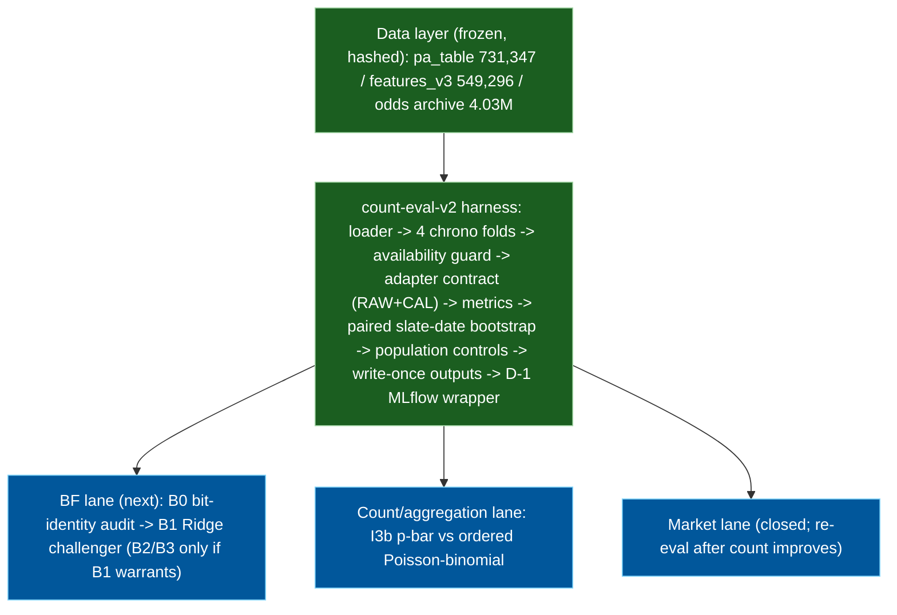

# 06 — Count-eval-v2 harness architecture (2026-10-16)

Owner-provided architecture of the count-eval-v2 comparison harness and the
registered future lanes. Companion narrative:
[`docs/reference/current_state_2026-10-16.md`](../reference/current_state_2026-10-16.md).
ASCII preserved verbatim from the owner 2026-10-16; this is a status map, not the work queue.

```text
+---------------------------------------------------------------------+
|                        DATA LAYER (frozen, hashed)                   |
|                                                                     |
|  pa_table.parquet (731,347 PAs)     features_v3.parquet (549,296)  |
|  start_metrics_v2.parquet           player_id_map.parquet           |
|  Odds archive (4.03M quote rows)    snapshot_envelope.parquet       |
|                                                                     |
|  All inputs sha256-hashed at registration; binary = byte-exact,    |
|  text = LF-normalized (TEXT_SOURCE_IDENTITY_CONVENTION)             |
+------------------------------+--------------------------------------+
                               |
                               v
+---------------------------------------------------------------------+
|                    COMPARISON HARNESS (count-eval-v2)                |
|                                                                     |
|  +-------------+   +------------------+   +--------------------+  |
|  | PA-row      |   | Fold derivation  |   | Availability       |  |
|  | loader      |   | (4 chronological |   | guard (src_date <  |  |
|  | (identity,  |-->| folds, runtime   |-->| game_date, fail    |  |
|  | dup guard)  |   | cal spans)       |   | loud)              |  |
|  +-------------+   +------------------+   +--------------------+  |
|                               |                                     |
|                               v                                     |
|  +--------------------------------------------------------------+  |
|  |              ADAPTER CONTRACT (per candidate)                 |  |
|  |  fit(base_train) -> calibrate(cal_block) -> predict_proba(eval)| |
|  |  RAW + CAL lanes separate; [0,1] shape check; no refit       |  |
|  +----------+----------------+----------------+-----------------+  |
|             |                |                |                     |
|             v                v                v                     |
|  +----------+     +--------------+   +------------------+          |
|  | P0_log5  |     | P1_B_logreg  |   | P1_H3_incumbent  |          |
|  | (identity|     | (6 features) |   | _refit (8 feat)  |          |
|  |  no fit) |     |              |   |                  |          |
|  +----------+     +--------------+   +------------------+          |
|                                                                     |
|  +--------------------------------------------------------------+  |
|  |  METRICS: log loss + Brier (RAW principal, CAL separate)     |  |
|  |  Per-fold + pooled row-weighted | per-tier | per-book        |  |
|  +--------------------------------------------------------------+  |
|                               |                                     |
|                               v                                     |
|  +--------------------------------------------------------------+  |
|  |  UNCERTAINTY: paired slate-date bootstrap                    |  |
|  |  Block-stratified | row-weighted ratio | shared draws        |  |
|  |  Null-centered approximate tests | Holm step-down | 2000x    |  |
|  +--------------------------------------------------------------+  |
|                               |                                     |
|                               v                                     |
|  +--------------------------------------------------------------+  |
|  |  POPULATION CONTROLS                                          |  |
|  |  One validated assignment | unknown/null labels fail loud    |  |
|  |  Dev-only headline | confirm reported separately             |  |
|  |  Tier A/B within each population | effective counts           |  |
|  +--------------------------------------------------------------+  |
|                               |                                     |
|                               v                                     |
|  +--------------------------------------------------------------+  |
|  |  OUTPUT LAYER (write-once, run identity = sha256(cfg+inputs))|  |
|  |  preds_<fold>__<cand>.parquet | metrics.json | bootstrap.json|  |
|  |  run_manifest.json (config/inputs/folds/versions)            |  |
|  |  confirm_metrics.json | tracking_status.json                 |  |
|  +--------------------------------------------------------------+  |
|                               |                                     |
|                               v                                     |
|  +--------------------------------------------------------------+  |
|  |  TRACKING WRAPPER (D-1)                                       |  |
|  |  compare -> save -> log -> verify (fresh-process retrieval)  |  |
|  |  MLflow failure surfaces (TrackingFailure, exit nonzero)     |  |
|  |  Canonical outputs preserved; no refit on upload failure     |  |
|  +--------------------------------------------------------------+  |
+---------------------------------------------------------------------+
                               |
                               v
+---------------------------------------------------------------------+
|                     FUTURE LANES (registered, not started)           |
|                                                                     |
|  BF LANE (B0->B1)                   COUNT/AGGREGATION LANE           |
|  +-----------------------+         +----------------------------+  |
|  | B0: bit-identity audit|         | I3b p-bar binomial (ref)   |  |
|  | B1: Ridge challenger  |         | vs ordered Poisson-binomial|  |
|  | BF PMFs not means     |         | Dispersion diagnostic      |  |
|  | RPS/MAE/coverage      |         | September drift tracked    |  |
|  +-----------------------+         +----------------------------+  |
|                                                                     |
|  MARKET LANE (closed, re-eval after count improves)                  |
|  De-vig benchmark | paper policy | CLV | ROI                        |
+---------------------------------------------------------------------+
```

## Compact Mermaid view (for the index graph)


