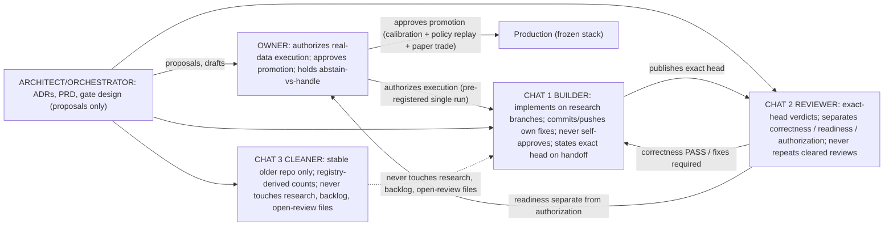

# 07 - Lanes and responsibilities (PROPOSED, 2026-10-21; revised)

> Answers: who builds, who reviews, who AUTHORIZES EXECUTION, and who
> APPROVES PROMOTION. Reuses the evidence-gate diagram (09) for the
> receipt chain. Owner decisions and builder actions are separated.

