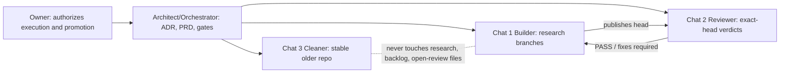

# 07 - Lanes and roles (PROPOSED architecture, 2026-10-21)

> Owner-approved draft pending integration. Status vocabulary matches the
> existing index (EXISTING, RESEARCH-BUILT, PROPOSED, REJECTED, UNRESOLVED).

