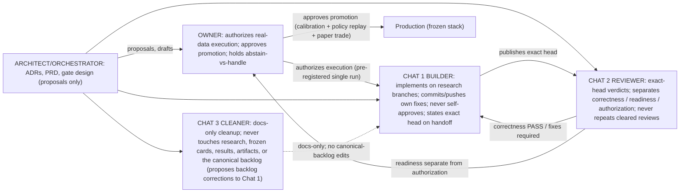

# 07 - Lanes and responsibilities (PROPOSED, 2026-10-21; revised)

> Answers: who builds, who reviews, who AUTHORIZES EXECUTION, and who
> APPROVES PROMOTION. Reuses the evidence-lifecycle states in diagram 13
> (diagram 09 was retired there; PR #40). Owner decisions and builder
> actions are separated.
> Role definitions are canonical at `docs/roles/` (ROLES_REV 2026-10-22-r2);
> where this diagram conflicts with them or `docs/NEXT.md`, those win.

