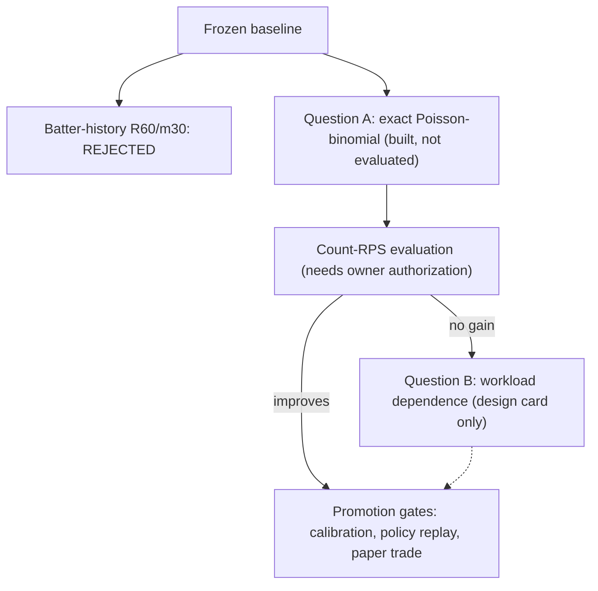

# 08 - Research decision flow (PROPOSED, 2026-10-21)

> Batter-history challenger REJECTED (R60/m30 recipe only, not recency
> modeling in general). Question A built, not evaluated on real outcomes.

