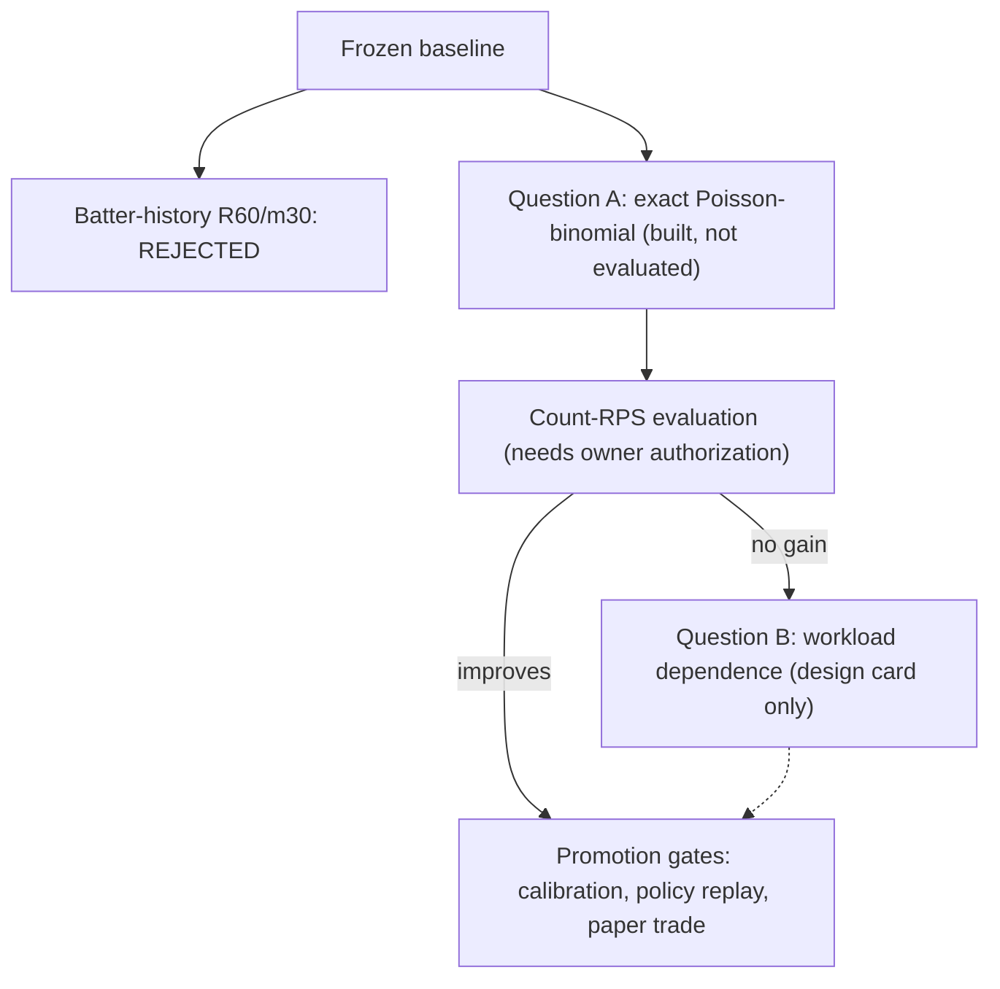

# 08 - Research decision flow (PROPOSED, 2026-10-21)

> Batter-history challenger REJECTED (R60/m30 recipe only, not recency
> modeling in general).
>
> Status correction 2026-10-29: the "Question A built, not evaluated" node
> below is STALE. Question A (exact Poisson-binomial) was EXECUTED once on
> 2026-10-21 (owner-authorized): count-RPS delta -0.0003333, challenger
> better, dev-only diagnostic, frozen baseline NOT replaced. Receipt:
> `research/offseason_2026/pregame_pa_ext/results_count_agg_eval_v1/RESULT_RECORD.md`.
> See also
> `research/offseason_2026/pregame_pa_ext/briefing_pa_model_and_architecture_2026-10-29.md`
> (registered aggregation = binomial conditionals at averaged cycled-slot
> probabilities, NOT Poisson-binomial).

