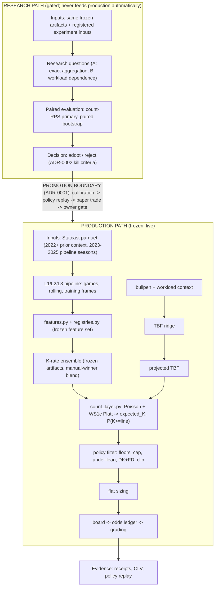

# 10 - System paths (PROPOSED, 2026-10-21)

> Answers: production path vs research path, inputs, model components,
> outputs, and the promotion boundary. Reuses diagrams 01 (production
> detail), 05 (live flow) and 08 (research decision flow) for depth -
> this is the boundary map, not a competing source of truth.

