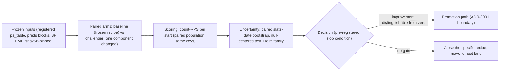

# 11 - Experiment evaluation flow (PROPOSED, 2026-10-21)

> Answers: what happens between frozen inputs and a decision for one
> experiment (Question A shape; the same skeleton applies to any
> pre-registered question under ADR-0001/0002).

