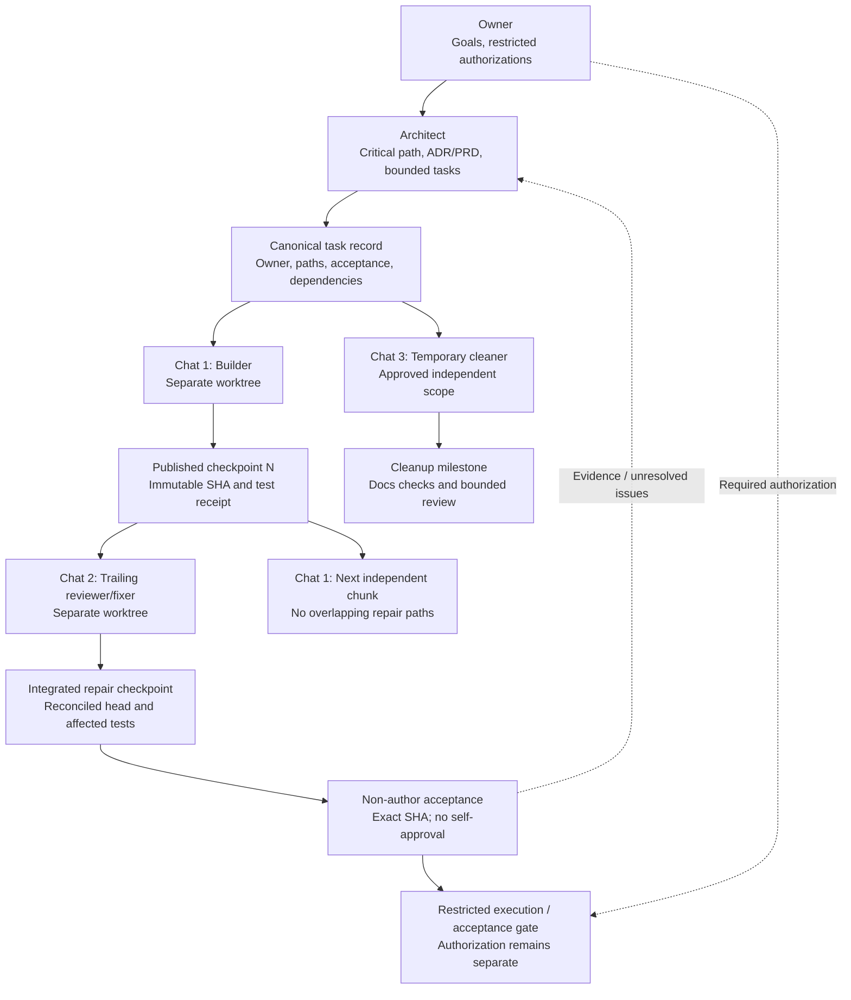

# 12 - Delivery and agent control (TARGET-STATE, PROPOSED 2026-10-21)

> Depicts the PROPOSED operating architecture, not a claim that all
> connections are implemented or validated. Existing diagrams remain until
> their consumers are checked.

