# 13 - Experiment evidence lifecycle (TARGET-STATE, PROPOSED 2026-10-21)

> Crucial distinction: a scientifically negative result can be a valid
> completed milestone. An invalid run is not a negative result.

```mermaid
stateDiagram-v2
    [*] --> Registered
    Registered --> Implemented: Contract translated into code
    Implemented --> SyntheticVerified: Entry point and failure paths tested
    SyntheticVerified --> IndependentlyChecked: Exact published SHA checked
    IndependentlyChecked --> Authorized: Required permission recorded
    Authorized --> Executed: Immutable run packet written
    Executed --> EvidenceChecked: Identity and inference audited
    EvidenceChecked --> AcceptedResult: Claims supported
    EvidenceChecked --> RejectedResult: Valid run; claim unsupported
    EvidenceChecked --> InvalidRun: Contract or implementation failure
    InvalidRun --> Registered: Superseding protocol or repair
    AcceptedResult --> PromotionReview: Separate operational decision
    RejectedResult --> [*]
    PromotionReview --> [*]
```

