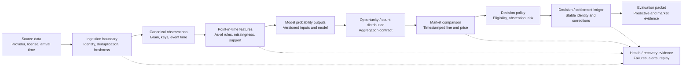

# 14 - Research-to-decision boundaries (TARGET-STATE, PROPOSED 2026-10-21)

> The repository already has pipeline, contract, lineage, and operational
> components; the recommendation is to clarify and validate their boundaries,
> not assume they need replacement. Dashed edges feed health/recovery evidence.

