# 15 - System map (PROPOSED, 2026-10-23)

> Detail view supplementing 01-architecture.md (the architecture overview):
> adds the file-cited layer-by-layer map with per-module status. 01 is the
> overview of record; where the two disagree, fix both.
> Dashed edges are health/monitoring side-channels.

```mermaid
flowchart LR
    subgraph SOURCES["Sources"]
        S1["Statcast parquet<br/>(2022 prior, 2023-2025 seasons)"]
        S2["SharpAPI odds<br/>(DK/FD, pregame + close)"]
        S3["Odds-API historical<br/>(theoddsapi archive)"]
        S4["RotoGrinders lineups<br/>(confirmed + projected)"]
    end

    subgraph INGEST["Ingestion (src/Python)"]
        I1["statcast.py<br/>refresh + incremental"]
        I2["daily_lineups.py<br/>RG + MLB IDs"]
        I3["sharp_odds.py<br/>odds polling"]
    end

    subgraph FEATURES["Point-in-time features (pipeline/)"]
        F1["pipeline/games.py<br/>pitcher_games, batter_games,<br/>pitch_type_games, park_factors"]
        F2["pipeline/rolling.py<br/>pitcher_rolling, batter_rolling,<br/>rest, lagged PA/Outs/Pitches,<br/>bullpen L1-L3d"]
        F3["pipeline/training.py<br/>pitcher_training, batter_training,<br/>lineup + prior-season park_k_factor"]
    end

    subgraph MODEL["Model (frozen)"]
        M1["features.py + registries.py<br/>production 184 features"]
        M2["models/Strikeout-Model/train.py<br/>Mean, Ridge, LightGBM<br/>TRAIN_SEASONS = 2023-2024"]
        M3["TBF ridge<br/>models/TBF-Model"]
        M4["count_layer.py<br/>Poisson live, WS1c Platt,<br/>expected_K + P(K>=line)"]
    end

    subgraph POLICY["Policy + sizing"]
        P1["kpi_policy.json<br/>floors, cap, under-lean,<br/>DK+FD, clip, game_cap"]
        P2["market.py<br/>stake calculation, 1/16-Kelly"]
    end

    subgraph OUTPUT["Outputs"]
        O1["odds_board.py<br/>live recommendation board"]
        O2["odds_ledger.py<br/>open + graded tickets"]
        O3["send_morning_alert.py<br/>ntfy board + flips"]
    end

    subgraph EVAL["Evaluation"]
        E1["grade_odds_ledger.py<br/>settle, CLV, ROI"]
        E2["kpi_policy gates<br/>probation, champion"]
    end

    S1 --> I1 --> F1 --> F2 --> F3
    S4 --> I2
    S2 --> I3
    F2 --> F3
    F3 --> M1 --> M2
    F2 --> TBF --> M3
    M2 --> M4
    TBF --> M4
    M4 --> P1 --> P2 --> O1 --> O2 --> O3 --> E1 --> E2
```

## Layers

| Layer | Directory | Key modules | Status |
|---|---|---|---|
| Ingestion | `src/Python/` | `statcast.py`, `daily_lineups.py`, `sharp_odds.py` | EXISTING |
| Features L1-L3 | `src/Python/pipeline/` | `games.py`, `rolling.py`, `training.py` | EXISTING |
| Features + registry | `src/Python/` | `features.py`, `registries.py` | EXISTING |
| Model training | `models/Strikeout-Model/` | `train.py` | FROZEN |
| TBF model | `models/TBF-Model/` | — | FROZEN |
| Count layer | `src/Python/count_layer.py` | `count_layer.py` | LIVE |
| Policy + sizing | `production/ops/` | `kpi_policy.json`, `market.py` | LIVE |
| Board + ledger | `production/odds/` | `odds_board.py`, `poll_odds.py`, `grade_odds_ledger.py` | LIVE |
| Cloud delivery | `production/cloud/` | `modal_app.py` | LIVE (5 crons) |

## Data flow summary

1. Statcast parquet (raw) -> `pipeline/games.py` -> L1 tables
2. L1 tables -> `pipeline/rolling.py` -> L2 rolling features
3. L2 -> `pipeline/training.py` -> L3 training frame
4. L3 + registries -> `features.py` -> 184-feature production vector
5. Features -> k-rate ensemble + TBF ridge -> count_layer -> P(K>=line)
6. P(K>=line) + policy filter -> recommendation board
7. Board -> odds_ledger -> grade -> evaluation
