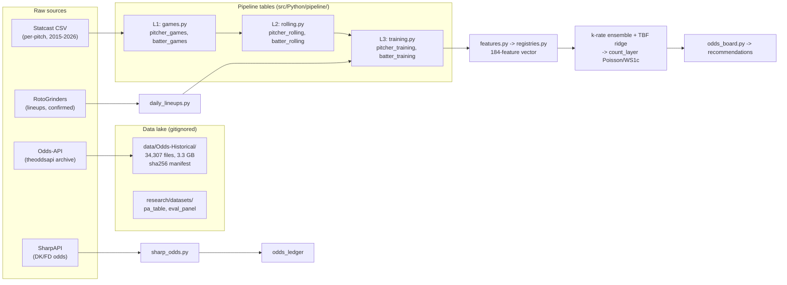

# 16 - Data lineage (PROPOSED, 2026-10-23)

> Tracks raw sources through the lake to production tables. The Odds-API
> historical archive lives outside git in `data/Odds-Historical/` (34,307
> files, 3.3 GB; sha256 manifest at `data/Odds-Historical.sha256`).

## Key tables

| Table | Grain | Source | Consumed by |
|---|---|---|---|
| `pitcher_games` | (pitcher, game) | Statcast | `rolling.py` |
| `pitcher_rolling` | (pitcher, game) rolling window | `games.py` | `training.py`, `features.py` |
| `pitcher_training` | (pitcher, game) + labels | `rolling.py` | `train.py` |
| `batter_training` | (batter, game) + PA features | `rolling.py` | `train.py` |
| `pa_table` | (PA, slot) | pregame-pa-ext pipeline | PA model, count eval |
| `pa_predictions` | (PA, slot, model) | logistic_pa experiment | count eval |
| odds ledger | (ticket, game, book) | `poll_odds.py` | `grade_odds_ledger.py` |
