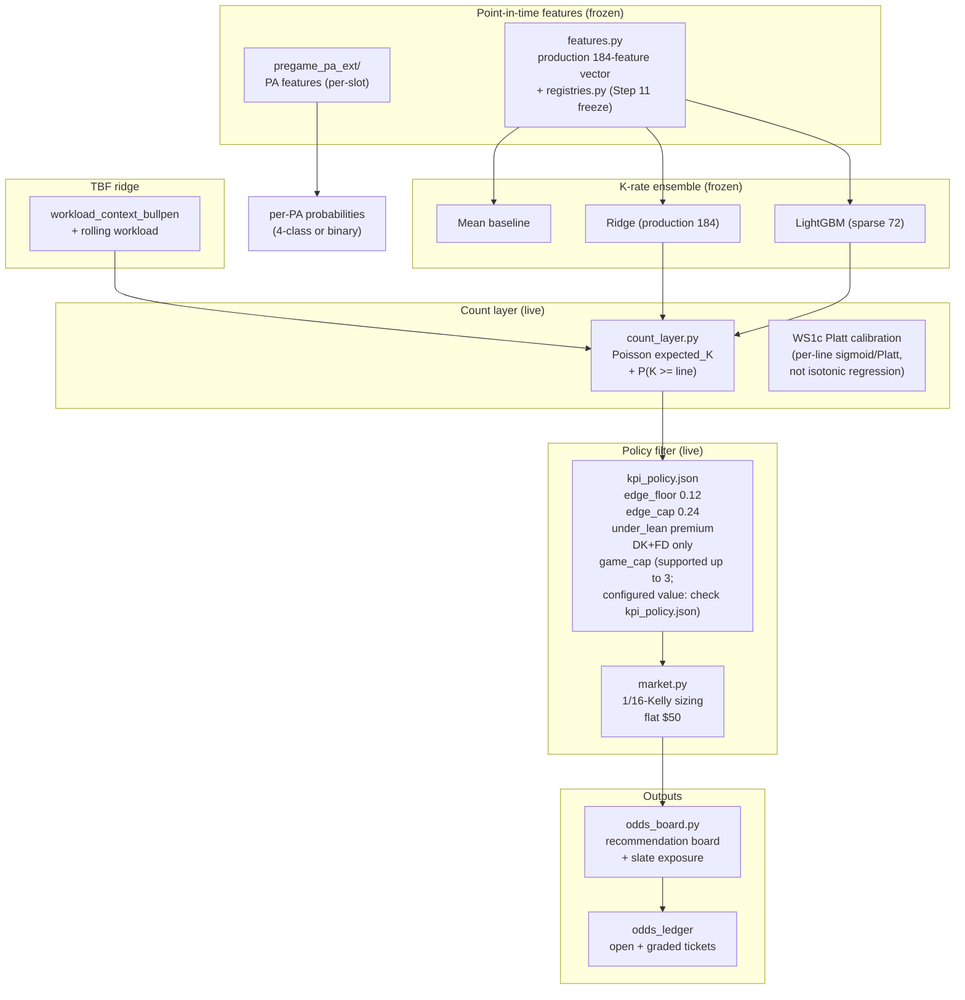

# 17 - Model pipeline (PROPOSED, 2026-10-23)

> Shows the frozen model pipeline from point-in-time features through count
> PMF and market comparison. Each node cites the implementing module.

## Feature pipeline detail

| Stage | Module | Input | Output |
|---|---|---|---|
| L1 | `pipeline/games.py` | Statcast parquet | `pitcher_games`, `batter_games` |
| L2 | `pipeline/rolling.py` | L1 tables | `pitcher_rolling`, `batter_rolling` (rolling windows, rest, bullpen) |
| L3 | `pipeline/training.py` | L2 tables | `pitcher_training`, `batter_training` (lineup + park factors) |
| Feature | `features.py` | L3 + registries | 184-feature production vector |
| Registry | `registries.py` | feature definitions | Step-11 frozen set |

## Model components (frozen)

| Component | Implementation | Trained on | Status |
|---|---|---|---|
| K-rate ensemble | `train.py` (Mean, Ridge, LightGBM) | 2023-2024 chronological split | FROZEN |
| TBF ridge | `models/TBF-Model/` | workload context + bullpen | FROZEN |
| Count layer | `count_layer.py` (Poisson) | per-game K distribution | LIVE |
| WS1c calibrator | Platt scaling per line | historical calibration set | LIVE |
| Policy filter | `kpi_policy.json` | 2025-lock champion selection | LIVE |
