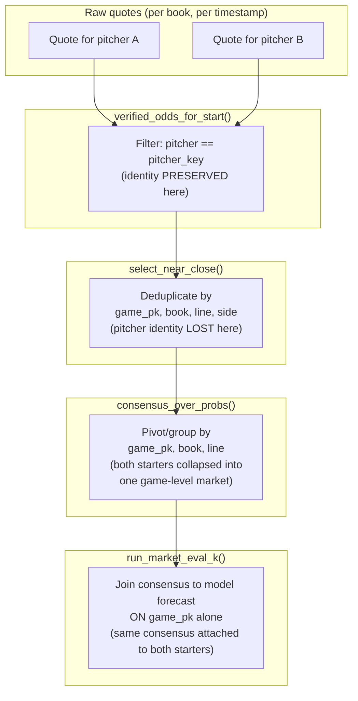
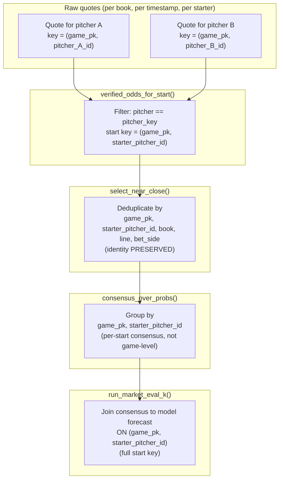

# 18 - Market identity chain

> **Historical flow** (top diagram): the superseded broken implementation at
> `6bee3f7`. Pitcher identity is filtered early but lost at dedup, consensus,
> and the model join.
>
> **Repaired flow** (bottom diagram): identity carried through every
> transformation as `(game_pk, starter_pitcher_id)`. Independently verified
> at the reviewed research SHA.

## Historical flow (broken at `6bee3f7`)

## Repaired flow (verified at the reviewed research SHA)

## Field definitions

| Field | Source | Meaning | Example |
|---|---|---|---|
| `pitcher_key` | Vendor (RotoGrinders / SharpAPI) | Vendor-specific pitcher identity used for matching quotes to a start | Vendor string or numeric key |
| `pitcher_id` (MLBAM) | Canonical MLBAM | Standardized MLB player identifier used for joins and model features | 605483 |
| `team_side` | Derived from game context | Which team the pitcher plays for in this game | home, away |
| `bet_side` | Derived from the betting market | Over/under direction of the betting market | over, under |

These must not share an ambiguous field name in the scored output. The
vendor `pitcher_key` is resolved to the canonical MLBAM `pitcher_id` by
`daily_lineups.py` and `identity.py` before entering the model pipeline.
