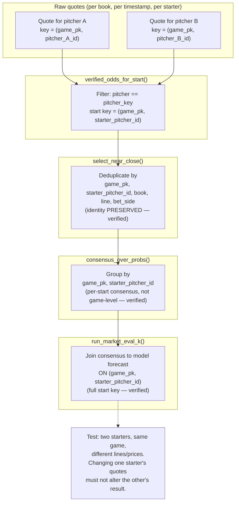

# 18 - Market identity chain (independently verified, 2026-10-23)

> **Historical section** depicts the superseded broken implementation at `6bee3f7`. **Repaired section** shows the required fix (identity carried through every transformation). Independent verification status: NOT YET VERIFIED — repair implementation pending.

> Shows the identity flow from raw odds quotes through model forecast join.
> The current implementation has a demonstrated player-mixing defect at
> `c07976d`: pitcher identity is filtered early but omitted from dedup keys,
> consensus construction, and the final model join. independently verified until the
> full start key `(game_pk, starter_pitcher_id)` is carried through every
> transformation.

```mermaid
flowchart TB
    subgraph RAW["Raw quotes (per book, per timestamp)"]
        Q1["Quote for pitcher A"]
        Q2["Quote for pitcher B"]
    end

    subgraph VERIFY["verified_odds_for_start()"]
        V["Filter: pitcher == pitcher_key<br/>(identity PRESERVED here — verified)"]
    end

    subgraph DEDUP["select_near_close()"]
        D["Deduplicate by<br/>game_pk, book, line, side<br/>(identity was lost here — historical defect, repaired)"]
    end

    subgraph CONSENSUS["consensus_over_probs()"]
        C["Pivot/group by<br/>game_pk, book, line<br/>(both starters collapsed<br/>into one game-level market — HISTORICAL DEFECT, repaired in the current implementation)"]
    end

    subgraph JOIN["run_market_eval_k()"]
        J["Join consensus to model forecast<br/>ON game_pk alone<br/>(same consensus attached to<br/>both starters — HISTORICAL DEFECT, repaired in the current implementation)"]
    end

    subgraph TARGET["Required behavior"]
        T1["Per-start consensus<br/>key = (game_pk, starter_pitcher_id)"]
        T2["Per-start forecast join<br/>key = (game_pk, starter_pitcher_id)"]
    end

    Q1 --> V
    Q2 --> V
    V --> D
    D --> C
    C --> J
    J -.-> "IDENTITY BREAK" .-> T1
    T1 --> T2
```

## Distinguishing side fields

| Field | Meaning | Example |
|---|---|---|
| `team_side` | home/away (which team the pitcher plays for) | home, away |
| `bet_side` | over/under (the betting market direction) | over, under |
| `pitcher_key` | canonical pitcher identity (MLBAM ID) | 605483 |

These must not share an ambiguous field name in the scored output.


## Repaired flow (required implementation)



## Verification status: independently verified at the reviewed research SHA

- Both starters retain their own consensus when present in the same game.
- Dropping one starter's quotes cannot borrow the opponent's consensus.
- Multiple snapshots/books cannot create start-level fan-out.
- Start-key uniqueness and unmatched counts reported at every boundary.
