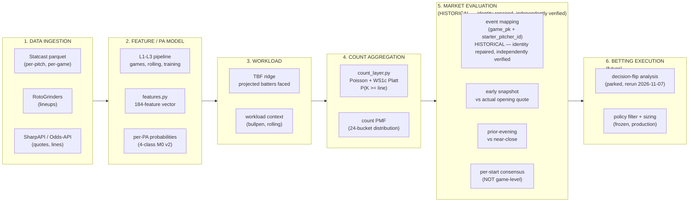

# 19 - Pipeline stages (PROPOSED, 2026-10-23)

> Six distinct stages with explicit boundaries. The market identity bridge
> (stage 5) is independently verified at the reviewed research SHA.

## Market timing documentation

| Timing concept | Definition | Current implementation |
|---|---|---|
| **Early snapshot** | Quote captured before the market settles (typically pre-dawn) | Logged at poll time; no separate snapshot label |
| **Actual opening quote** | The first quote the book posts for a market | Not currently distinguished from later quotes |
| **Prior-evening** | Quote from the evening before the game (typically 20:00+ ET the prior day) | Captured by overnight polling |
| **Near-close** | Quote close to first pitch (within the T-45 urgency gate) | Captured by urgency-gated sweeps |

The distinction between early snapshot and actual opening quote is not
currently implemented. The poll captures whatever the book shows at each
timestamp; there is no separate "opening" label.
